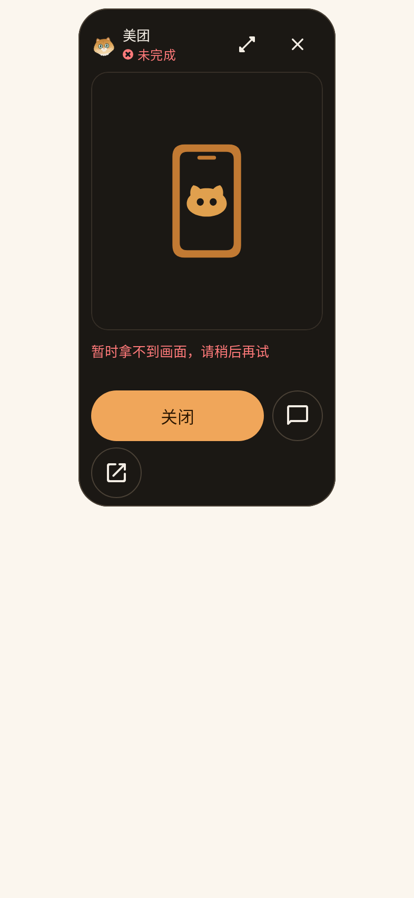
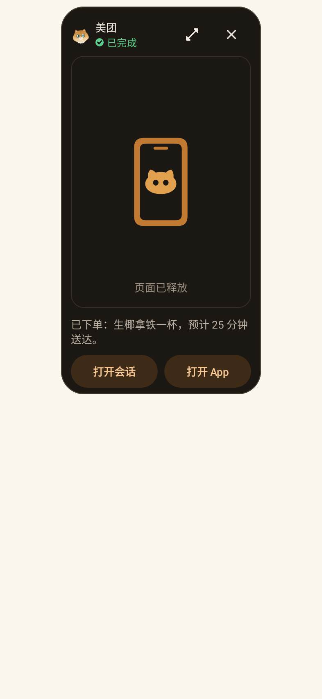

# 阶段 8.1 · 预览窗完成态与弹出逻辑

- 基线：`ed0c2e8`，对应 `03-screens.md` §S12、S5 和 `04-implementation-plan.md` 阶段 8.1。
- 交付版本：`3.3.5` / **2026110616**；引擎仍为 `20261105-e49-parallel-observe`。
- 本阶段一次提交、一次发布。签名包以 [GitHub Releases](https://github.com/Lmin2419/eta-background/releases) 中 versionCode 2026110616 为准；对应提交的 [Etax Build](https://github.com/Lmin2419/eta-background/actions/workflows/etax-build.yml) 必须完成检查、签名构建和发布三个 job。

## 逐项结果

| 规格 | 修改前 | 修改后 / 自动验证 |
| --- | --- | --- |
| S12.1 缺帧与任务状态分离 | `frameUnavailable` 与失败共用分支，成功、运行中也变成未完成 | Mapper 只按任务结果选择终态；缺帧只控制页面动作。成功仍已完成；运行中仍正在执行，接管禁用，显示非红色「正在等待画面…」 |
| S12.2 完成、失败、停止操作行 | 橙色大主按钮、操作行关闭、另起 FlowRow 的恢复按钮 | 同一行两个等宽 40dp Tonal「打开会话」「打开 App」；页面还在时尾部追加 40dp TouchApp「操作页面」。无会话只显示一个全宽「打开 App」。关闭仅保留头部 |
| S12.2 结果与页面释放 | 释放画面可触发未完成和红色取帧提示 | 成功显示结果首句，失败显示原因；原生手机猫占位图下补三语 `textTertiary`「页面已释放」，不显示红色取帧错误。停止显示「已停止」 |
| S12.3 完成通知正文 | 有目标 App 时一律打开预览窗 | 任务已完成且会话非空时打开对应 MainActivity 会话；无会话回退不变。成功、失败、停止均覆盖 |
| S12.3 其他入口与弹出时机 | 运行通知、任务条、任务中心打开预览；窗口内状态更新 | 这些入口保持不变。完成时只刷新原窗口，没有新导航、自动关闭或自动放大 |
| 现有动作与防重入 | 接管、交还、打开 App 各有独立处理 | 原动作处理器不动；忙碌、缩放、关闭期间禁用操作，手动模式和交接模式优先级不变 |

## 先失败，再修复

先在未修改生产代码的 `ed0c2e8` 上新增三组测试，再运行：

```text
:app:testDebugUnitTest
  --tests io.github.mangi.eta.agent.runtime.Stage81*
  --tests io.github.mangi.eta.ui.components.Stage81*
```

基线 **25 项，15 失败、0 错误**：Mapper 7 项失败、原生渲染五种场景各失败、完成通知在 API 33/36/37 各失败。其他通知回退和截图采集通过。失败断言直接指出错误 mode、错误 PendingIntent、橙色主按钮等，不以编译失败作为复现。

- [Mapper 失败报告](stage-8.1/before/TEST-io.github.mangi.eta.agent.runtime.Stage81PreviewMapperTest.xml)
- [渲染失败报告](stage-8.1/before/TEST-io.github.mangi.eta.ui.components.Stage81PreviewRenderingTest.xml)
- [通知失败报告](stage-8.1/before/TEST-io.github.mangi.eta.agent.runtime.Stage81NotificationTest.xml)

修改后新增三组测试 **28 项全通过**。另外覆盖停止标签、无会话单按钮、原窗口内完成、暂停/需要你时缺帧、忙碌/缩放/关闭、通知三个独立动作与无会话回退。原有行为断言按 S12 更新，没有跳过或删除测试。

本地相关回归共 **84 项，0 失败、0 错误、0 跳过**（[汇总](stage-8.1/local-regression.txt)），包含 TaskPreviewActivity、TaskPreviewImageView、TaskPreviewControl、Stage6Surfaces 的真实触摸回归、Stage8Layout、通知和 Mapper；[新增测试通过报告](stage-8.1/after/)。接线检查 12/12 通过。

本地 `:app:lintDebug` **BUILD SUCCESSFUL，0 错误**（[摘要](stage-8.1/local-lint.txt)）。全量单测、引擎部署测试、Lint、签名构建和 APK 配对检查由同一提交的 Linux CI 完成；Windows 本地未重复运行已知依赖 POSIX Shell 的全量套件。签名发布结果以该提交的 Actions 和 Release 为准。

原生渲染断言检查状态文字、提示颜色、Tonal 实际背景像素、40dp 按钮高度、按钮等宽、所有操作垂直居中同一行、只有一个关闭、操作页面可见性、完整按钮文字以及真实点击回调。CJK 字形浮点宽度与整数像素宽度有舍入差，文字检查采用单行、无省略、无高度溢出和字形宽度不超过边界 1 像素；未通过缩小字号掩盖问题。

## 五种场景的前后截图

全部由 Robolectric 原生 Compose + AndroidView 渲染，预览宽 **244dp**、字号 **100%**。浅/深色指宿主 canvas；按 S5 预览浮窗自身保持固定深色。保留页面使用标明 Test fixture 的合成页面，避免误当真实订单；不是手机截图。修改前快照还填入旧 Activity 的底部操作标记，修改后随旧字段删除该 fixture 接线。

| 场景 | 修改前浅色 | 修改前深色 | 修改后浅色 | 修改后深色 |
| --- | --- | --- | --- | --- |
| 成功，页面还在 | [查看](stage-8.1/before/stage81-success-page-light.png) | [查看](stage-8.1/before/stage81-success-page-dark.png) | [查看](stage-8.1/after/stage81-success-page-light.png) | [查看](stage-8.1/after/stage81-success-page-dark.png) |
| 成功，页面已释放 | [查看](stage-8.1/before/stage81-success-released-light.png) | [查看](stage-8.1/before/stage81-success-released-dark.png) | [查看](stage-8.1/after/stage81-success-released-light.png) | [查看](stage-8.1/after/stage81-success-released-dark.png) |
| 失败，页面还在 | [查看](stage-8.1/before/stage81-failure-page-light.png) | [查看](stage-8.1/before/stage81-failure-page-dark.png) | [查看](stage-8.1/after/stage81-failure-page-light.png) | [查看](stage-8.1/after/stage81-failure-page-dark.png) |
| 失败，页面已释放 | [查看](stage-8.1/before/stage81-failure-released-light.png) | [查看](stage-8.1/before/stage81-failure-released-dark.png) | [查看](stage-8.1/after/stage81-failure-released-light.png) | [查看](stage-8.1/after/stage81-failure-released-dark.png) |
| 执行中，暂时无画面 | [查看](stage-8.1/before/stage81-running-waiting-light.png) | [查看](stage-8.1/before/stage81-running-waiting-dark.png) | [查看](stage-8.1/after/stage81-running-waiting-light.png) | [查看](stage-8.1/after/stage81-running-waiting-dark.png) |

成功但已释放的关键对照：

| 修改前 | 修改后 |
| --- | --- |
|  |  |

## 范围核对

生产修改仅 `PreviewWindowState`、`EtaPreviewWindow`、完成通知 `setContentIntent`，以及 `TaskPreviewActivity.updateControls` 的只读展示字段：删除旧 FlowRow 的三个字段，补充停止标签。新增「页面已释放」简中、繁中、英文资源。

[范围检查和散列](stage-8.1/scope-check.txt) 确认以下文件相对基线未改变：`TaskPreviewImageView`、`CompletedAppActivity`、`TaskPreviewRegistry`、`TaskScreenSession`、`AgentRuntimeRunExecutor`。Activity 的取帧、RPC、轮询、触摸/几何、接管、交还、打开 App、窗口安全属性均无修改。通知按钮、自动清除设置、远程回复、运行中通知入口未改；猫资源和引擎未改。

按用户规则委派腾讯入口：`coding` 使用 `cn:glm-5.3` 提供 Mapper 最小方案；`quick` 使用 `cn:deepseek-v4.1-flash` 提供通知测试草案；`review` 的 `cn:deepseek-v4-pro` 75 秒、`cn:kimi-k3-1` 55 秒超时后由 `cn:glm-5.3` 完成复核。主会话核对后修正了草案里的错误签名/断言并运行全部上述验证；未直接采用未经检查的补丁。

## 真机验收清单

安装 **2026110616** 的签名 APK，浅色、深色各走一遍：

1. 成功任务完成后点通知正文，直接进入正确会话并看到结果；失败、手动停止的任务也进入各自会话。
2. 通知上的「打开会话」「打开 App」「继续指令」分别仍执行原动作，继续指令不弹新页面。
3. 从任务条/任务中心打开已完成任务：有页面时显示最终页面，两个等宽小号 Tonal 按钮和末尾「操作页面」图标；只有头部关闭，底部没有第二行按钮。
4. 成功且页面已释放：仍是「已完成」，结果正常，画面区出现「页面已释放」，没有红色缺帧错误，也没有「操作页面」。
5. 失败任务分别检查页面还在/已释放：保留「未完成」与真实失败原因；释放只改变占位说明，不改变任务结果。停止任务显示「已停止」。
6. 运行中刚打开或暂时拿不到画面：仍「正在执行」，提示「正在等待画面…」，接管置灰；画面恢复后可接管，暂停仍可用。
7. 无会话的终态预览只显示全宽「打开 App」；无会话完成通知的原有点击行为不变。
8. 保持预览窗打开直到任务结束：原窗口切换成完成态，不自动关窗、放大或跳到 App/会话。
9. 有页面时点「操作页面」，检查点击、滑动、返回键和交还；「打开 App」仍走原有前台打开流程。运行中的通知正文、任务条和任务中心「查看」继续进预览。

自动测试及 CI 结果与 ColorOS 真机结论分开记录，本记录不冒充已完成手机验收。
