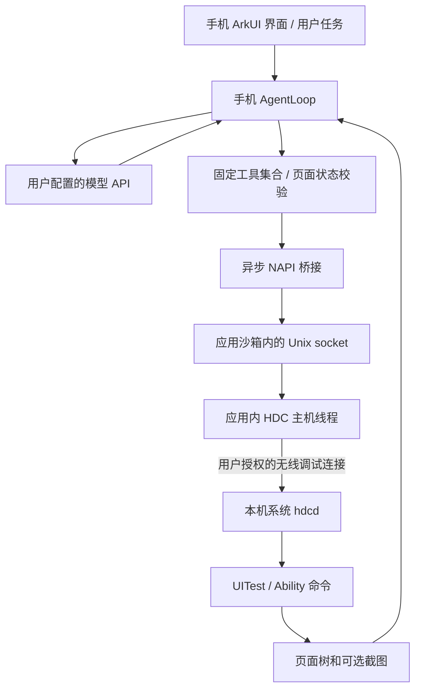

# 架构

电脑只用于开发和初次签名安装，不在上述运行链路中。远端模型服务器是推理端，不能直接持有本机 HDC socket。应用内 HDC 只监听沙箱 Unix socket，不另开一个其他应用可以直接调用的 TCP 控制端口。

## 可借鉴与需重写的部分

Eta 的任务循环、工具注册分层、执行后再观察、调用 ID 与工具结果配对、用户接管、限制任务轮数，这些思路与操作系统无关。Android AccessibilityService、Activity/Intent、设备输入和屏幕采集实现不能直接搬到 ArkTS。

本版采用原生 ArkUI + 可单测的 TypeScript 核心 + C++ HDC/NAPI。没有使用 WebView 容器或另起电脑 Python 服务。鸿蒙执行器目前使用 UITest CLI，后续可在同一 `DeviceTools` 接口下切换到设备端受控 worker；AgentLoop 与模型 API 不需要因此重写。

## 状态与失败语义

1. 多会话记录、全局单轮执行，手机工具串行调用；模型一次最多 8 个工具请求。每个操作需要最新页面观察，上一动作返回的新观察会使旧 ID 无效。
2. 页面树的尺寸、文字、bounds、类型、可点击/可编辑性和部分状态参与指纹。输出最多 120 个节点，校验遍历整棵可处理树，超 10000 节点拒绝执行。
3. 暂停、继续、停止、页面变化和动作发出后清理观察状态；暂停期间返回的旧模型动作不能使用旧观察继续点击。
4. 原生层使用独立异步工作、串行 socket、长度前缀帧、输出上限与截止时间；HDC CLI 命令以 NUL 终止，握手布局与官方主机一致。
5. 每个 shell 命令在子 shell 中执行，并在外层追加退出码标记。连接断开或标记缺失视为结果未知，不根据一段 stdout 就报成功，不自动重放有副作用的操作。
6. 动作前的页面校验与动作注入不原子化；屏幕若在两者之间变化，仍可能误触。这是当前执行器的实际边界，不能用单元测试掩盖。
7. `TaskSession` 管理后台授权和执行：授权等待中停止、切后台期间停止或通知提前取消后，即使系统晚到地返回授权成功，也不会启动 Agent；已经获得的资源会释放。
8. `HarmonyBackground` 提供默认短时任务和可选定位持续任务。后者申请大致位置权限，使用低功耗位置订阅，注册取消/暂停/定位开关回调，并每 3 秒校验自身定位权限。位置数据不进入 Agent 核心，定位模式没有系统后台定位 ACL 权限依赖。细节见 [后台机制](BACKGROUND.md)。

## 后续推进顺序

1. 在 Pura X Max 实测本机授权、加密 HDC 兼容性、UITest 输出格式、内外屏坐标和中文输入。遇到具体设备错误后按日志调整，不猜测 OS 7 私有行为。
2. 对照验证短时模式和定位持续模式中的完整低风险任务；测量模型响应耗时、控件读取耗时、通知取消效果和后台耗电。定位持续模式的代码已加入，不等于已经获得真机长期留存结论。
3. 实测系统通知点击返回、删除停止，以及定位撤权与系统挂起的停止行为；再决定是否补充悬浮停止入口。
4. 研究“授权启动设备侧 worker → 后续手机进程管理 worker”的路线，确认 OS 7 关闭无线调试是否保留会话与权限。该路线仍须经过用户授权，不预设进程永久存活。
5. 确认设备闭环后，再增加应用目录、长按、规则跳广告、按需触发。密钥安全存储已在 0.2 接入，待真机验证。
6. 按 [Eta 功能对齐](ETA_ALIGNMENT.md) 推进聊天、网页、工作区、记忆、扩展与普通授权工具；没有权限的工具不纳入。

## 模型配置（0.2）

`ProfileRepository` 仅保存白名单元数据；Key 使用独立的 ASSET 引用。更新时先写入新的安全资产，再以临时文件 + fsync + rename 更新元数据，最后清理旧资产；元数据写入失败保留旧配置与旧 Key。程序崩溃可能留下无引用的安全资产，不会把新地址绑定旧 Key。平台存储仍须真机验证。

`/models` 和合成连接测试不依赖 HDC。网络不跟随重定向、限制响应大小、认证与原始错误内容不写日志。HTTP 仅在用户明确开启时允许；API 23 以下阻止模型网络请求，避免依赖不支持的禁止重定向选项。当前仅实现 OpenAI Chat Completions，其他协议在对齐清单中单列。

## 会话与执行（0.3）

`ConversationRepository` 管理有界会话、搜索、模型引用、步骤与导出；写操作串行化。应用只在原子文件写入成功后发布新内存状态，载入失败不覆盖原文件。步骤只存受控的工具名称、时间与结果状态，不存原始参数、页面或截图。普通聊天不提供工具 Schema，Loop 也独立拒绝意外工具请求。

`ConversationRun` 是一次性执行协调器：先持久化用户轮次，再构建 Loop/TaskSession；停止在等待存储、模型、后台授权或动作校验期间都生效。每个动作前的 journal 必须成功，才可执行设备工具。动作发出后结果记录失败，下一轮不会自动重试。重启时原有 running 轮次/步骤转为 interrupted，仅恢复展示记录。

新一轮只从历史投影 user/assistant 文本，不复用原始 tool_calls、页面坐标或图片。保留最近最多 20 轮、48000 字符的完整轮次，保留更早本地历史。中断轮次附带结果未确认标记；系统提示要求以本轮目标为准并重新观察。模型自行选择的再次操作与程序重放是不同问题，仍需查看真实页面和用户目标。

当前全量历史文件有 200 万字符上限，采用快照保存，长历史写入性能仍须真机测量。未提供流式、插话队列、自动摘要或消息编辑/重新生成。

统一唤起入口由 singleton EntryAbility 接收固定 URI，向页面发送计数信号；不解析外部任务参数。热启动打开聊天，GUI 执行期间请求暂停；冷启动等历史载入完成再处理。电源键绑定尚无经验证的普通权限路径，见 POWER_KEY.md。

## 0.4 状态与生命周期隔离

模型表单集中在 ModelDraft，地址事件先判同值；异步诊断捕获 ModelSettings 快照，结果只更新状态/目录，不写回输入。请求期间允许编辑，若地址/密钥/模型改变则不采用旧请求的目录。已保存配置的编辑草稿仅在本进程 Map 中保留。

BackgroundService 持有用户手动启动的持续任务，GUI TaskSession 通过 lease 借用；单轮释放不关闭用户会话。系统撤销/用户停止先取消借用任务，再等在途申请结束后清理，迟到授权不能恢复运行。

TaskNoticeQueue 串行与合并普通任务通知更新，最终状态封闭后续进度。EntryAbility 仅对匹配当前进程随机 nonce 的显式 task-stop Want 提交停止；普通 assistant URI 仍只打开页面。不接收外部任务文本或模型配置。

EntryAbility 统一配置窗口背景、透明系统栏，读取系统/挖孔/手势安全区并监听尺寸变化；Index 背景延展，交互内容使用同一份 inset。键盘由 RESIZE 避让，弹出时隐藏底部导航。模糊使用 ArkUI backdropBlur，可关闭。

## 0.5 流式与目录

HarmonyHttpTransport 使用 requestInStream，分别等待成功状态码和 dataEnd，UTF-8 解码保留跨数据包状态；destroy/取消唤醒等待者。SSE 解析器处理帧边界、工具增量与结束原因，AgentLoop 仅在整轮完成并校验后执行工具。请求从不自动重发；忽略 stream 参数的 JSON 服务在同一响应内解析。用户可按服务关闭 streaming。

服务元数据增加 models 与 streaming，旧配置迁移为原模型的单元素目录；会话增加 preferredModel 以记住同一服务下不同模型。所有字段兼容旧存储。API 目录使用固定同源 /models 加 after/limit 分页，未知 next URL 不携带密钥跟随；最大 50 页、5000 个去重模型，部分目录明确提示。

UI 流式快照只更新当前消息，约 80ms 合并；回合结束、失败或停止时通过原串行存储写入部分/完整文字。失败片段可以阅读，但不会当作成功助手回复写回模型上下文。进程强杀时当前未完成回合的尚未落盘片段可能丢失。
