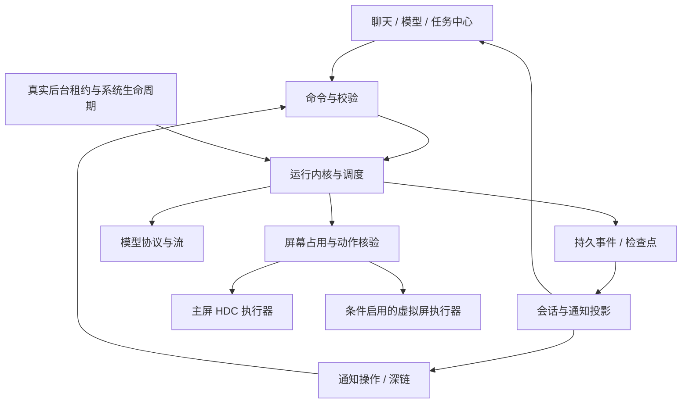

# 鸿蒙助手对齐自有 Eta 后台版：实施方案

编制日期：2026-10-29。目标设备：Pura X Max / HarmonyOS 7，按设备实际 API 与授权结果验收。
本文件是**开发方案与验收标准，不是新版本完成说明**。当前鸿蒙代码基线为 0.5.0。

## 1. 建议采用的目标与范围

以你们的 **Lmin2419/eta-background** 为主要产品参照：沿用它的会话流程、模型服务管理、任务控制、通知操作、排队与中断语义、动作效果核验；界面使用 ArkUI，系统交互使用鸿蒙 API 和已授权的本机 HDC 实现。

交付目标分成三个明确层级：

| 层级 | 交付内容 | 完成标准 |
| --- | --- | --- |
| A：日常主版本 | 完整聊天与模型管理、流式正文、可查看的执行过程、可靠任务控制、会话与通知关联、本机主屏 GUI、基本文件与数据管理 | 可在目标手机签名安装；日常无需电脑；本文发布门槛全部通过 |
| B：功能扩展 | 更多模型协议、图片/文件、网页与浏览器、记忆、Skills、MCP、语音、子任务、角色、普通授权系统工具 | 每个模块独立验收，逐步覆盖 Eta 可迁移功能，不把入口占位视为完成 |
| C：条件能力 | 实况窗、系统悬浮入口、长时间后台资格、第三方 App 虚拟屏、关闭无线调试后持续运行、电源键入口 | 先验证资格与完整闭环；成功才进入可用功能，失败有明确替代路径 |

A 版要尽量贴近 Eta 的日常体验；B 是进一步接近完整功能面。C 不以一个“实验开关”冒充已经可用，也不让某个特殊权限阻塞正常聊天开发。

**后台执行是 A 版的核心验收项之一。** 若普通账号与目标系统只能提供有时限的运行额度，就必须明确展示时间/状态并能可靠暂停保存；在长期运行资格尚未验证前，不能把它描述为“完整全天候后台助手”。虚拟屏功能更不能靠主屏操作悄悄替代。

日常无需电脑不等于无需联网：模型调用依赖所配置 API；本机 GUI 当前依赖有效无线调试会话。首次安装、证书更新和必要的调试授权仍可能用到电脑。

## 2. 本次审阅的证据范围

### 2.1 固定源码版本

| 来源 | 本次基线 | 用途 |
| --- | --- | --- |
| 自有私有仓库 Lmin2419/eta-background | `8ae286a8993efaa4650426ae450ab4634f2b2354` | 主要产品和执行行为参考 |
| 自有另一仓库 Lmin2419/Eta | `3019c43ce60cf53ebe1c2ba5ec86ec630830f39d` | 当前快照对照；不把其所有变化归因于你的新增 |
| 本地 harmony-agent | 0.5.0 | 已实现能力与缺口基线 |
| 鸿蒙 SDK | 26.0.0.105 | API、权限与接口限制核对 |

已经取得两个仓库的完整目录元数据：后台版 1,142 个文件，另一版 1,068 个；后台版独有 79 个路径，同名内容不同 73 个，对照版独有 5 个。这是**路径与 Git blob 的快照比较，不是共同祖先之后的提交归因**。

从后台版提取了 176 个相关文本文件，重点审阅通知、运行时、虚拟屏、GUI 证据、聊天/模型页面及关联测试。没有逐行阅读全部 1,142 个文件，没有在本次运行 Android 测试，也没有连接你的手机做鸿蒙实测。提取范围及哈希见 [审阅清单](ETA_FORK_AUDIT.json)，源码与 SDK 证据编号见 [证据索引](ETA_PARITY_EVIDENCE.md)。

私有仓库 README 记录了 Android 测试结果，但也写明部分 ColorOS 通知视觉表现待真机验证；这些不能直接算作鸿蒙验收。当前鸿蒙 0.5 的 112 项测试和编译记录见 [VALIDATION.md](VALIDATION.md)，主要验证纯逻辑与构建，不能证明后台权限、通知交互或折叠屏表现。

### 2.2 按当前代码确定行为，排除历史撤回策略

你们仓库的历史文档较长，最终采用的行为必须以当前实现为准：

- 息屏暂停，亮屏不自动继续；不沿用旧的强行保持屏幕唤醒策略。
- 当前执行容量为 2，包含队列的未结束任务上限为 8；同一会话串行提交，同一 App 的虚拟屏执行串行。
- 完成后保留虚拟屏页面等待接管；不照搬已撤回的“一分钟后自动销毁”。
- 通知被删除、已经继续对话或因容量回收后，不因迟到归档重新出现。
- 操作返回成功不等于页面变化，更不等于用户业务目标已完成。

## 3. 主要差距与对齐决定

| 模块 | 自有 Eta 当前逻辑 | 鸿蒙 0.5 现状 | 实施决定 |
| --- | --- | --- | --- |
| 模型服务 | 独立编辑草稿；目录候选搜索、多选确认；绑定连接与账号 | 已有目录分页/搜索导入、测试、配置保存；草稿主要在内存 | 保留现有底层，补持久草稿、请求代次、独立详情页、精确状态与协议适配 |
| 聊天 | 消息列表、流式 Markdown、推理折叠、工具过程、模型切换、队列/插话 | 已有 SSE、基本 Markdown、紧凑输入和会话列表；真机待测 | 按 Eta 信息结构重写；补独立状态、编辑重试、附件、推理摘要与执行过程 |
| 会话/任务关系 | 多会话、多运行状态投影，完成归档与页面分离 | 页面持有单轮运行和全局 liveReply | 先拆运行内核，再增加并行；切页不能把 A 会话内容画到 B |
| 任务通知 | 每任务独立卡片、终态原卡更新、暂停/继续/停止、完成三入口、回复、一次提醒 | 固定 ID 4001；通用返回入口；完成仅“查看结果” | 每任务稳定 ID、准确深链、卡片本体+两按钮、回复闭环、删除标记与提示去重 |
| 长期后台 | Android Service、执行连接与系统通知配合 | 短时额度和定位持续任务实验；普通通知不能保证存活 | 分离运行租约、通知状态、调试连接；真实资格探测后确定支持范围 |
| 任务队列 | 2 个执行位、8 个未结束任务；队列与插话有严格收尾顺序 | 全局单任务 | 第一阶段保持单执行，内核稳定后才开放 2；实体屏只有 1 个 GUI 占用位 |
| 动作核验 | accepted / CHANGED / NO_OBSERVED_CHANGE / UNKNOWN；无进展抑制 | 有旧观察、尺寸、超时校验；语义效果核验不足 | 移植证据模型与防空转逻辑，鸿蒙重新实现采样与输入 |
| 虚拟屏 | Android 特权引擎、独立 display 输入/采集/页面保留与接管 | 只读诊断及 ACL 后创建/释放实验 | 单独研究分支，必须逐关验证；创建成功不开放模型 screen_* 工具 |
| 外观 | 模糊材质、侧栏、底部输入、主题、键盘适配 | 已有原生页面，真实可读性仍需复测 | ArkUI 设计系统统一实现；优先可读性、布局和反馈，再加材质与动效 |
| 其他 Eta 能力 | 网页、文件、记忆、Skills、MCP、语音、角色等 | 多数未实现 | 见第 12 节，按权限与依赖分批纳入，不能笼统标“已对齐” |

## 4. 鸿蒙能力边界与探测方案

统一提供 CapabilityRegistry，返回：
`available / permission_required / disconnected / unsupported / unverified`，附原因、API 版本、验证时间与所用执行身份。
页面入口、工具注册和给模型的能力说明读取同一份状态。未知能力默认不暴露为可执行工具。

| 能力 | 已确认的接口/限制 | 方案与失败处理 |
| --- | --- | --- |
| 应用自身通知 | NotificationKit 可发自己通知；手机最多 2 个按钮；isOngoing/isUnremovable 在本 SDK 标为不支持 [H01] | 普通通知作为基础；不靠这两个字段保证常驻 |
| 通知内输入 | NotificationActionButton.userInput 是公开接口 [H02] | 先实测系统渲染、输入结果投递、锁屏及冷启动；不可用时“继续”进入准确会话并聚焦输入 |
| 通知删除回调 | removalWantAgent 只支持公共事件 [H01] | 验证接收生命周期；持久化删除标记，结合本应用活动通知查询恢复，不能假设 Android Receiver 等价存在 |
| 实况窗/状态栏胶囊 | HMS LiveViewKit 有 start/update/stop；有权益错误码，场景包括 PROGRESS [H03] | 查实际账号可申请场景与权益；通过才启用。NotificationKit 的系统级 Live View 限制不能代替对 HMS 路线的判断 |
| 悬浮球/悬浮面板 | floatingBall、API 26 floatView；相关权限有 system_basic/ACL 条件 [H04] | 验证签名资格及用户授权、显示/关闭/输入避让。失败使用通知及应用内面板 |
| 普通短时后台 | 有系统额度与取消回调 | 用来收尾或受限任务，不承诺长任务连续执行 |
| 特殊长时后台 | MODE_SPECIAL_SCENARIO_PROCESSING 的现有子场景是媒体处理/视频投播等，API 24+ 需要专门 ACL [H05] | 不能凭“特殊”二字认定任意 AI 推理适用；未证实匹配场景前不作为保活方案 |
| 定位持续任务 | 现有实验实现，需要权限/系统接受/真实回读 | 保留诊断隔离；截图里别的 App 有定位通知不证明我们的任务获批，更不证明无限运行 |
| 主屏 GUI | 本机 HDC/UITest，独立于应用 UID | 按目标机实际命令和结果测试；断连、超时、息屏时禁止盲点；不依赖电脑驻留 |
| 虚拟屏 | 创建权限 ACCESS_VIRTUAL_SCREEN 受限；迁移、定向截图、输入是独立问题 [H06] | 见第 11 节八关验证，不能只验证权限开关 |
| 长按电源键 | 尚未找到普通应用可替换小艺处理的已验证路线 | 统一助手 URI、通知入口、桌面入口纳入；电源键保持研究项，不显示虚假“启用成功” |
| 其他应用通知/私有数据 | 与发送自身任务通知不是同一权限 | 不默认做全局通知收集器或私有数据库读取；支持用户主动导入内容 |

“有 SDK 声明”“开发者能申请”“你的证书能签出”“系统给权”“功能完整闭环”要分别记录。编译通过最多证明第一步和类型兼容。

## 5. 产品页面与交互：按 Eta 流程落地

### 5.1 页面结构

建议主入口保持“聊天 / 模型 / 设置”，将设备、运行任务、权限诊断纳入可直接访问的设置分组；聊天标题栏放任务中心入口。宽屏时会话侧栏常驻，窄屏使用抽屉，不在聊天上方长期堆放模型说明和诊断卡片。

| 页面 | 内容 | 关键交互 |
| --- | --- | --- |
| 聊天 | 标题、模型状态、消息列表、折叠执行过程、输入栏 | 流式阅读、暂停/停止、回到底部、模型选择、附件、补充/插话/排队 |
| 会话列表 | 搜索、分组、最近状态、新建、更多 | 切换保留草稿与滚动位置；活动任务继续由运行内核管理 |
| 任务中心 | 执行中、排队、需处理、近期完成 | 明确任务所属会话和占用屏幕；单任务控制，不提供误导性的假进度百分比 |
| 模型服务 | 服务列表、连接详情、已添加模型、目录导入 | 草稿与保存状态分离；测试不清空内容；失败原因定位到步骤 |
| 设置 | 外观、运行与通知、设备连接、工具、数据与备份、语音、扩展 | 危险/受限能力不与常规外观开关混在一起；展示真实状态 |
| 设备诊断 | HDC、后台租约、系统授权、可用显示、实验报告 | 输出可导出的脱敏报告；不把所有失败归成“权限不足” |

### 5.2 聊天视口与折叠屏

- 页面纵向约束固定为标题、弹性消息区、输入区、导航；只计算一次系统安全区。
- 外屏默认正文 16fp，次级文本 13–14fp，点击区至少约 44vp；颜色使用语义 token，不用大面积低对比灰字。
- 内屏按 vp 实际宽度决定双栏，建议 840vp 以上开启侧栏，实际阈值以 Pura X Max 可读性验收调整；侧栏约 240–300vp，正文阅读宽度约 680–820vp。
- 不根据照片的像素分辨率直接写死 ArkUI vp 尺寸。
- 输入框 1–6 行自动增高，超过后内部滚动；键盘出现时消息区缩小，发送/停止始终可见。
- 折叠、旋转、切会话保持文本草稿、已选附件和消息锚点；不因重新布局重发网络请求。
- 用户在底部时跟随新内容；向上拖动立即停止跟随；显示“回到最新”，不能用每个 token 的强制滚动把人拉回底部。
- 高斯模糊使用 ArkUI 材质/背景模糊接口，先限定标题和输入面板；深浅色、降低透明度及性能不足时退回实色。应用内模糊与跨 App 浮窗是两个能力。
- Markdown 支持段落、标题、列表、引用、链接、代码块复制、表格横向滚动；流式未闭合标记不能造成整页重排或崩溃。长代码懒渲染，不给每条消息新建 WebView。

### 5.3 消息与执行过程

消息分成正文、服务返回的推理内容/摘要、工具过程、附件和状态。只有服务实际返回可展示字段时才显示“思考”区；不编造推理、不把工具 JSON 直接当正文刷屏。

每次工具调用显示：动作名称、目标、正在执行/已返回/结果待核对、耗时、可折叠的脱敏输入输出；操作后观察单独记录。任务结束显示最终回复、未完成项及用户下一步。

提供复制、编辑后重新发送、重新生成、导出、删除；编辑和重新生成创建新运行并保留旧分支或明确的修订历史，不能删除已经发生的手机动作记录。仅重放聊天上下文，不自动重放旧工具。

运行中三个发送语义沿用仓库 [S13]：

| 动作 | 语义 |
| --- | --- |
| 补充本任务 | 在明确边界把补充内容加入当前运行；不抢在正在提交的工具前后无序插入 |
| 排队发送 | FIFO 等当前回合自然结束；可以撤回编辑/删除 |
| 立即插话 | 请求停止旧运行，等收尾落盘后优先开始新运行；保留其他队列 |
| 用户主动停止 | 当前任务停止，其他排队消息保留且不自动启动 |

撤回排队消息时保留输入框原有草稿并合并，不能覆盖用户刚输入的内容。停止、切模型、编辑历史都应有确定状态，而非靠页面按钮临时判断。

### 5.4 模型连接与目录导入

流程对齐 [S14][S15]：

1. 创建/选择服务，编辑名称、协议、地址、凭据。
2. “连接并获取模型”使用当前草稿发请求，不要求先保存，也不要求先猜模型名。
3. 返回可搜索目录，只列尚未加入的候选；默认不勾选，支持按当前筛选结果全选、跨搜索保留勾选。
4. “添加选中模型”只把所选模型加入该服务；关闭面板不改变目录。
5. 测试所选模型，分别展示文本、流式、工具能力结果；视觉另测，不能由文字成功推断。
6. 保存服务，聊天模型选择器立即看到新增模型；每会话记住选择。
7. 后续刷新不会清空已有配置或自定义模型，服务不提供 /models 时允许手动添加。

接口返回的“全部模型”指**该凭据下接口实际公开、并在支持的分页协议内完整取得的目录**。保留 0.5 的 5,000 项/50 页资源上限及部分目录提示；不静默截成 200 个，也不宣称能枚举服务端未开放的模型。未知分页协议增加适配器后再标为完整。

防止输入框重置的具体约束：

- ProviderDraft 与 SavedProvider 分开，测试只写 TestResult，目录只写 PendingCatalog。
- 每个异步操作携带 providerId、draftRevision、connectionFingerprint、credentialGeneration、requestId；过期响应不覆盖当前服务。
- 真正修改服务地址后旧凭据失效；同值 onChange、测试失败、保存结果回填均不能误清 Key。
- 编辑草稿元数据可持久化；密钥只按用户的安全保存设置进入 ASSET，不随普通草稿写明文。
- 401/403、429、超时、JSON 错误、空目录、部分目录分别显示；失败保留草稿与已添加模型。
- 测试只发合成验证请求，不连接手机工具、不执行模型返回的真实动作。
- 模型被删除时相关会话标为待选择，不能自动改到另一个服务发出历史。

## 6. 运行架构：让页面、通知和模型共享事实

当前需要优先拆分 `Index.ets`：它同时管理表单、网络、流式文本、运行、后台与持久化，并在 `aboutToDisappear()` 中停止任务。切页与任务寿命耦合，会阻碍通知继续、多会话和恢复。

下面是拟新增模块，不表示文件现已存在：

| 层 | 模块 | 职责 |
| --- | --- | --- |
| core/runtime | RunRegistry / RunStateMachine / TaskScheduler | 接纳任务、运行状态、队列、取消代次、执行位 |
| core/runtime | GuiLease / AppLease / BackgroundLeasePolicy | 实体屏互斥、同 App 互斥、后台额度策略 |
| core/events | RunEvent / ConversationProjector / NotificationProjector | 同一事件生成会话、任务中心、通知的状态 |
| core/storage | EventStore / CheckpointStore / Migration | 事务、崩溃恢复、归档、升级 |
| core/models | ProviderDraft / ProtocolAdapter / StreamAssembler | 配置草稿、协议差异、流式增量与工具拼接 |
| core/device | CapabilityRegistry / ActionEvidence / ObservationStore | 权限事实、动作证据、坐标与观察时效 |
| platform | HarmonyRuntimeHost / BackgroundLeaseManager | 绑定 Ability 生命周期和合法后台机制；不承诺脱离系统管控 |
| platform | HarmonyNotificationAdapter / LiveViewAdapter | 通知路由、系统按钮、权限、去重和实况窗 |
| platform | HdcConnectionManager / MainDisplayDriver / VirtualDisplayDriver | 调试连接、主屏执行、可选虚拟屏 |
| features | chat / providers / tasks / settings | ArkUI 页面、局部草稿、展示状态，不直接持有工具执行循环 |

推荐依赖关系：



HarmonyRuntimeHost 是应用内组织方式；不能仅给类取名 Service 或增加 Worker 就获得 Android 前台 Service 的生存能力。UI 退出时解除订阅；系统资源真的被回收时检查点保存、运行标记中断。

### 6.1 标识与一致性

每个命令至少关联 conversationId、runId、requestId；GUI 增加 displayId、displayLeaseId、observationId、frameId、geometryEpoch；取消/重连增加 generation。通知另有稳定 notificationId 和一次性操作标识。

- 事件有单调 seq，重复回调按 runId+eventId 去重；旧 generation 的网络/工具回调不能改变新运行。
- 同一会话只允许一个写入者，旧运行收尾提交之前不能开始新运行。
- 模型响应、通知发布和后台租约失败分别记事件，不互相冒充业务结果。
- 工具调用执行前写入 intent；结果写入失败时标记结果未知，不重发动作。
- 重启恢复根据持久状态判断，不根据“按钮还在转”推断运行仍存活。
- 主屏任务回到助手时暂停以免把后续点击打到助手自己；纯聊天切页继续；虚拟屏通过独立验证后另定策略。

### 6.2 任务状态机

| 状态 | 可转移到 | 触发与约束 |
| --- | --- | --- |
| queued | preparing / cancelled | 取得执行位后再分配网络/GUI 资源 |
| preparing | waiting_model / paused / failed | 校验模型、凭据、能力、存储及所需租约 |
| waiting_model | executing_tool / committing / paused / cancelling / failed | 工具参数完整且能力仍有效才执行 |
| executing_tool | observing / paused / cancelling / failed | 只执行一次；超时可能已执行，进入未知结果处理 |
| observing | waiting_model / paused / committing | 观察更新与效果证据提交 |
| paused | preparing / cancelled | 记录原因；用户继续时重新校验并观察，不能复用旧坐标 |
| cancelling | committing | 取消请求，禁止启动下一动作；无法撤回已提交的系统动作 |
| committing | completed / failed / cancelled / interrupted | 先保存终态再生成通知；通知失败不覆盖业务终态 |
| interrupted | 新运行 / cancelled | 显式恢复或继续；不自动重放未知动作 |

pauseReason 至少区分用户暂停、息屏、用户接管、连接断开、授权失效、后台额度到期。亮屏、网络恢复、打开应用均不自动续做主屏动作。

### 6.3 并发与队列

先保持一个执行任务验证完整状态机，再按自有仓库上限开放“2 个执行位 / 8 个未结束任务”，两者均可配置并有容量提示。

**两个执行位不等于可以同时点击实体屏。** 主屏 GuiLease 只有 1 个；可以测试一个 GUI 任务加一个纯聊天任务并行。同一会话串行，同一 App 的虚拟屏串行，资源未确认释放前不能腾出显示容量。

队列取消不创建模型连接。用户停止不自动启动剩余队列。任务不足后台资格时不能用排队积累无限待执行副作用。

## 7. 通知交互：迁移你们仓库最有价值的逻辑

参考 [S01][S02][S03][S17]。通知是持久任务的视图，不是另一个独立状态机；不能靠页面临时变量拼装。

### 7.1 每个状态的显示和操作

| 任务状态 | 标题与正文 | 点击卡片 | 按钮 |
| --- | --- | --- | --- |
| 排队 | 任务名、队列状态 | 对应会话/任务 | 取消；必要时查看队列 |
| 执行 | 正在做的步骤、运行时间 | 对应会话 | 暂停、停止 |
| 暂停 | 暂停原因、保留的进度 | 对应会话 | 继续、停止 |
| 完成且有已确认目标 App | 结果简述 | 对应会话 | 打开 App、继续对话 |
| 完成但无目标 App | 结果简述 | 对应会话 | 继续对话；不显示猜测的 App |
| 失败/中断 | 未完成原因 | 对应会话定位失败步骤 | 查看/处理；继续入口按能否恢复决定 |

鸿蒙普通手机通知只能有两个按钮。因此保留三种用户意图的方式是：**卡片本体进入会话，按钮一打开 App，按钮二继续**。不能照搬 Android 三按钮代码。

主屏模式的“打开 App”只能使用已核验的 bundle/ability 或链接，尽力回到现有任务；不承诺恢复不可持久的页面。若以后虚拟屏通过验证，则使用对应 display lease 做保留页面接管。接管结果未知时不偷偷 force-stop/relaunch。

### 7.2 发布、更新和提醒

- notificationId 与 runId 稳定关联并持久化，避免不同任务都写入 4001。
- 运行进度按有意义的变化合并，初始建议 750–1,000ms；终态立即排入串行发布队列。
- completed/cancelled/interrupted 后禁止迟到进度覆盖；重复完成只处理一次。
- 完成卡保留近期最多 3 张，任务历史完整保留。新一批任务可按你们现有策略清理旧完成卡，清理策略不删除会话。
- 完成提醒单独设“完成时提醒我”；进度默认静默，提醒失败不影响结果卡和记录。
- 亮屏且已解锁、通知权限和分类允许、卡片仍存在、未提醒过时才尝试一次完成提醒；系统决定是否横幅展示。
- 锁屏/息屏期间完成不主动点亮屏幕、不在解锁后补放过期横幅；用户关闭提醒也不删除结果。
- 可参考仓库的短合并窗口与等待上限，但鸿蒙具体数值通过设备验证调整，不机械照搬 Android 通知时间参数。

### 7.3 删除、点击与冷启动

删除通知记录 notificationId/runId 的 tombstone；迟到归档、旧进度或重新打开应用不能把它复活。首次发布后优先以 updateOnly 更新已有卡片，卡片不存在时不改成普通 publish 重建。使用 removalWantAgent 公共事件时先验证权限和进程不在场的投递行为；收不到回调时，在恢复时查询本应用活动通知作保守校对，不批量重发旧完成卡。

深链必须包含经过校验的会话与运行引用；冷启动先加载存储，再定位对应消息。热启动不覆盖当前未发送草稿。其他应用构造同名 URI 不得伪造已授权停止、回复或工具执行命令。

### 7.4 通知内继续对话

1. 通过公开 userInput 能力验证输入是否可见及结果如何送达；测试普通解锁、锁屏、后台、进程已退出四种情况。
2. 校验来源 runId、conversationId、一次性操作标识及文本长度（可沿用 16,000 字符上限）；重复回调只接纳一次。
3. 加载已保存会话、源任务最终结果及尚待归档结果，按 runId 去重。
4. 校验当前模型配置是否还可用；模型删除/凭据失效时保留输入，引导到对应会话修复，不能换服务重发。
5. 为继续对话创建新 runId，不重用旧运行，也不把旧手机工具重新执行。
6. 持久接纳成功之后才处理旧完成卡；失败保留卡片及可恢复草稿。
7. 若系统不支持实际内联输入或后台接纳条件不满足，“继续”打开对应会话并聚焦输入，交互意图和上下文仍然一致。

通知回复不能承诺任意状态都在后台执行；合法租约不足或涉及主屏接管时，先恢复到可交互状态。

### 7.5 三种通知/入口不能混淆

| 类型 | 负责什么 | 不代表什么 |
| --- | --- | --- |
| 本应用任务通知 | 任务进展、结果、暂停/继续/停止 | 不自动授予后台运行时间 |
| 系统持续任务通知 | 系统认可的后台任务及退出入口 | 不等于自定义 Eta 卡片，不能保证可隐藏或合并 |
| LiveViewKit 实况窗 | 权益许可场景的胶囊/通知/锁屏展示 | 不自动保活，也不自动提供 GUI 权限 |

普通卡片先完成全部语义。实况窗通过资格验证后复用同一 NotificationProjection；申请失败退回普通通知并解释一次，不循环申请。不能用配送、打车或定位等不匹配场景包装 AI 执行。

## 8. 数据、流式与错误恢复

### 8.1 数据方案

建议从当前 JSON 快照逐步迁移到鸿蒙关系型数据库：conversations、messages、runs、run_events、provider_metadata、drafts、notification_state、capability_evidence；附件保存在受控文件目录，密钥继续使用 ASSET。

- 迁移先备份旧文件，再事务导入并验证计数/引用；完成标记落盘后才切新库，失败保持旧数据可读。
- 保留现有数据上限的明确提示；长期版本支持分页与清理，不通过截断未告知地丢会话。
- 当前回合文本建议每 500–1,000ms 合并检查点，并在工具前后、暂停、停止、终态强制提交；实际频率需测写放大和耗电。
- 流式 UI 更新可沿用 0.5 约 80ms 合并，不逐 token 重绘全文或写整库。
- 崩溃恢复只能承诺恢复已提交内容；尚未检查点的片段可能丢失，要给出可测上限而非声称零丢失。
- 截图与完整工具数据按需、限量、限期保存；日志默认只记录 ID、耗时、错误类，不记录 Key/完整认证头。
- JSON 备份/导出默认不含密钥。附件和记忆导出让用户选择范围；导入校验版本与总量。
- 数据迁移后降级必须按备份规则处理，不能直接用旧 APK/HAP 覆盖后强读新结构。

### 8.2 模型流与协议

保留 0.5 已实现的真正 SSE 传输、UTF-8 分片、取消、工具片段完整性校验；补跨会话状态隔离、推理字段、结构化使用量与协议适配。

每种协议独立声明：模型目录、流格式、工具调用、图片、推理参数、上下文预算。先稳定 OpenAI Chat Completions，再接 Responses / Anthropic / Gemini；不把三者都塞进一个“兼容 OpenAI”开关。

截断、无 finish、服务返回错误、重复工具 ID、取消后尾包均有确定处理。服务不支持流式时明确设置非流式；已经发送的生成请求失败不自动再发一次造成重复计费或执行。

上下文压缩与 token 预算按模型信息执行；未知 tokenizer 使用保守估算并标记。压缩保留用户目标、未完成约束及工具结果摘要；不能将未知动作摘要成已成功。

### 8.3 错误反馈

统一错误含阶段、可恢复性、操作是否可能已执行、用户下一步。页面至少能区别：
模型鉴权失败、目录不可用、流中断、存储失败、HDC 断开、后台资格未获、租约被取消、通知被禁、动作结果未知。

“测试失败”不能清空表单；“通知失败”不能改成“任务失败”；“网络恢复”不能自动重放动作；“通知有卡片”不能显示“后台服务已稳定常驻”。

## 9. 主屏 GUI：从“能点”做到“能确认”

参考自有仓库 [S06][S07][S09][S10]，将跨平台可复用的判断逻辑迁到纯 TypeScript，输入与采样由鸿蒙适配器负责。

### 9.1 工具范围与统一返回结构

第一批覆盖观察/截图、节点与坐标点击、长按、滑动、拖动、输入与清空、返回/桌面、启动已知 App、条件等待、滚动容器、用户接管/释放。每个工具先验证目标系统具体命令能力，再进入注册表。

拟采用的工具结果结构：

```json
{
  "operationId": "op-...",
  "accepted": true,
  "outcome": "UNKNOWN",
  "operationMayHaveRun": true,
  "target": { "displayId": 0, "geometryEpoch": 4 },
  "beforeObservationId": "obs-...",
  "afterObservationId": "obs-...",
  "reason": "输入已提交，尚无可比较的目标变化"
}
```

结果分四类：REJECTED、CHANGED、NO_OBSERVED_CHANGE、UNKNOWN。另设 goalVerification，表示业务目标有无独立验证；不沿用含糊的“verified=true 就是任务成功”。

例如“点击发送”：输入被系统接受是一层，页面新增消息是一层，消息确已成功发送又是一层。模型不能仅凭命令退出码宣布业务成功。

### 9.2 观察与坐标

每个观察记录显示 ID、屏幕实际尺寸、旋转、缩放、采样时刻、页面指纹与 epoch。折叠/展开、旋转、显示变化、重连或用户接管后 epoch 递增，旧坐标全部失效。

截图坐标和设备显示坐标明确标注，带 frameId 才能换算；不把 Eta 前台归一化坐标、后台截图坐标和 ArkUI vp 混用。节点 ID 仅在该观察范围内有效。

密码/敏感输入节点不回传内容；截图仍按用户截图设置控制。观察不可得、Canvas 节点不可比较时返回 UNKNOWN，不能把“树没变化”解释成点击失败或已经到底。

### 9.3 滚动与无进展

- 多滚动容器时要求明确选择器、节点或命中点；不默认找最大的容器。
- 比较目标容器的内容和相对位置，避免页面倒计时、广告等无关变化误判滚动成功。
- 可沿用仓库“同目标连续 3 次无可验证进展，第 4 次拒绝”的原则；只在观察可比较时累计。
- 记录按任务/显示/方向/目标划分，有限容量与 TTL；页面变化、目标改变、观察受限时清空相关计数。
- 先重新观察或换方式，不通过反复销毁/重启 App 解决输入不生效。

### 9.4 暂停、接管与重连

输入命令超时可能已经作用在手机上。先标记 operationMayHaveRun，再观察；无法观察就暂停，不自动重试点击/输入/提交。

用户回到助手时主屏任务暂停；通知“继续”应先检查亮屏解锁、连接和租约，再让助手退出前台并重新观察。息屏暂停，解锁后仍等待用户继续。连接变化先断开旧会话、清空目标并重新核验身份，禁止复用旧 socket 的未确认结果。

## 10. 后台机制：以真实状态替代实验开关

### 10.1 三个独立状态

界面同时展示但不混为一谈：

1. **执行状态**：任务是否运行/暂停/排队。
2. **后台资格**：没有租约、短时额度、系统已接纳的持续任务、取消中或已取消。
3. **调试连接**：未连接、已授权、连接中、断开、结果未知。

通知发布成功不能把后台资格改成“持续”；定位权限弹窗点了允许也不能在持续任务回读之前显示“已启动”。

### 10.2 验证与实现顺序

- 先做最小能力试验：通知许可、普通任务通知、持续任务申请与回读、系统撤销回调、切后台后的网络/HDC、息屏恢复。
- 以系统正式说明核对业务匹配的后台模式。API 26 特殊模式目前列出的媒体处理/投播不天然覆盖通用 Agent。
- 现有定位实验单独显示申请阶段、错误码及系统通知状态；位置数据不因后台用途顺带进入模型。
- 若长期资格不成立，主版本做任务时间预算、检查点和明确暂停；长任务入口提示实际限制，不能无限显示“执行中”。
- 手动启动的合法运行租约与单任务借用分开计数；单任务结束不能误停手动租约，最后持有者退出必须释放。
- 系统撤销、删除持续任务通知、权限被撤回时立即停止启动新工具并保存状态；已提交操作结果仍按未知结果处理。
- Worker/TaskPool 只用于计算与隔离，不能充当保活替代；不加入无声音乐、伪造定位用途或隐藏窗口维持运行的生产依赖。
- 日常电脑断开测试单独记录：模型可用、本机 HDC 可用、后台可用是三项，不用安装成功代替。

### 10.3 本阶段必须回答的设备问题

| 检查 | 需要记录的证据 | 决策影响 |
| --- | --- | --- |
| 普通通知能否出现/更新/操作 | 通知设置、发布结果、按钮投递记录、截图 | 决定通知适配路径 |
| 删除系统持续通知的实际行为 | 任务取消回调、租约回读、执行停止时间 | 决定资源释放与 UI 状态 |
| 主屏执行退后台后的存活 | 网络、HDC、租约时间线 | 决定能承诺的连续任务时长 |
| 屏幕关闭/解锁 | 状态事件与工具发起记录 | 验证不自动续做、不点击锁屏 |
| 应用被系统终止 | 最后检查点、重启恢复及旧通知路由 | 验证无重放、无错误“仍运行” |

## 11. 虚拟屏：八关验证后才叫“后台操作 App”

你的仓库不是只调用一个 createVirtualDisplay：它还使用 Android ImageReader、display 定向输入、ActivityTaskManager 迁移、独立焦点、输入就绪检查和页面保留 [S08][S11]。这些 Android 类不能直接在鸿蒙运行。

### 11.1 先查两种执行身份

- **应用身份路线**：正常应用签名及合法 ACL；验证 display/window 等公开接口。
- **已授权 HDC 身份路线**：核对该 ROM 的系统工具帮助与可执行能力；shell 能力单独记录，不能由应用权限结果推断。

两条路线均无可用接口时，结论就是该设备普通可获取权限下不能实现此闭环；不会把 Root 或系统签名混入普通用户方案。当前的 ACL 补丁只是请求声明，不会自动授予权限。

### 11.2 八关实验与通过条件

| 关卡 | 实验 | 通过证据 | 失败时处理 |
| --- | --- | --- | --- |
| V1 权限 | 读取签名权限、API/系统能力、真实调用错误 | 能合法获得所需权限；错误能区分无资格与运行问题 | 保留诊断，禁用入口 |
| V2 创建释放 | 创建一个小尺寸测试屏，读取 ID，再释放；重复验证 | 显示 ID 可核验，释放后无残留，进程退出可回收 | 先解决泄漏，不进入下一关 |
| V3 自有页面渲染 | 将自有测试 Ability/窗口呈现在目标显示 | 目标 ID/窗口确实匹配，主屏无误切换 | 确定 API 限制，不能跳到三方 App |
| V4 定向采集 | 采集该屏测试图案、文字和几何 | 图案与尺寸匹配，能持续取帧，非主屏镜像 | 无采集就不进入模型闭环 |
| V5 定向输入 | 对自有测试页点击、滑动、中文输入 | 目标页计数/文本变化，主屏触摸与焦点不被抢 | 禁止三方 App 自动化 |
| V6 第三方 App | 从白名单测试 App 开始，启动/迁移到目标屏 | App 与窗口在指定屏，输入和截图仍有效 | 仅保留自有虚拟页面能力，不宣称通用 |
| V7 保留接管 | 完成后保存页面、用户点击通知接管、再释放 | 页面不被重启，接管失败不丢任务，资源可回收 | 不上线“打开执行结果 App”接管功能 |
| V8 稳定隔离 | 旋转折叠、后台切换、取消、异常、容量及同 App 争用 | 不误触主屏、不交叉截图、不泄漏、不错误重放 | 限制容量或退回实验通道 |

V1–V5 仅证明测试场景能力；V6 之后仍须列明支持 App/场景。安全窗口、DRM、单实例与多显示限制按实测展示，不能承诺所有 App。

### 11.3 通过后的集成

- 先开放 1 个虚拟屏，稳定后再评估你们仓库的 2 个屏幕容量。
- 统一 MainDisplayDriver / VirtualDisplayDriver 观察与输入契约；由模型实际能力选择工具，不在失败时静默切主屏。
- 每任务独立 displayLeaseId；保留页面占用容量，未确认释放不复用；同一 App 互斥。
- 15 个 screen_* 工具按当前 Schema 逐项适配，包括 open/state/tap/swipe/press/drag/text/click/wait/scroll/list/dump/shot/diag/finish，不能只留同名空壳。
- 已完成屏幕保留至用户接管、明确释放或容量回收策略触发；长期保留受系统资源限制，不承诺进程死后仍保留。
- 默认息屏暂停、不自动亮屏执行；用户点击接管才迁移回主屏。
- 所有后台引擎通信需要身份验证、协议/构建版本与实际健康检查，不能仅靠端口可连接判断就绪。

**C 线停止条件**：普通合法签名与已授权 HDC 均不能完成 V5/V6 时，记录证据并停止对“通用后台虚拟屏”的继续承诺；仍可交付主屏助手。该项的失败不应促使引入系统签名绕过。

## 12. 尽可能完整地覆盖 Eta 功能

旧的 [129 项工具清单](ETA_TOOL_INVENTORY.csv) 保留为能力目录；其中历史版本状态不能替代本方案与 0.5 状态。逐项迁移时新增 toolId / permission / effect / cancellation / evidence / tests 六项契约，按模块验收。

| 功能组 | 实施内容 | 鸿蒙实现与边界 | 批次 |
| --- | --- | --- | --- |
| 聊天与模型 | 多服务、目录、流、图片、推理档位、工具、修订/重试、上下文压缩 | 网络/ArkUI/ASSET；协议分开适配 | A 优先，协议扩展 B |
| 文件工作区 | 导入、预览、读写、精确编辑、搜索、导出 | 应用沙箱与用户选择器授权；原子写入、大小上限、路径约束 | A 基础，B 完整 |
| 网页搜索 | 可配搜索后端、抓取、引用、缓存 | 网络接口；网页内容只是数据，不能扩大工具权限 | B1 |
| 内置浏览器 | ArkWeb 页面、DOM、截图、标签、接管 | 自有 Web 视图范围；外部浏览器需要 GUI 路线 | B1 |
| 长期记忆 | 查看/编辑/关闭/清空、预算注入、检索 | 自有数据库/文件；会话与角色记忆隔离 | B1 |
| Skills | 列表、资源读取、ZIP/GitHub 导入、版本/冲突/卸载 | 资源与说明可实现；脚本执行另查执行器能力 | B1 |
| MCP | 远程 Streamable HTTP、鉴权、工具开关、取消、重连 | 请求凭据与服务绑定；未知结果不重放外部副作用 | B2 |
| 子任务 | 次模型、模板、独立上下文、结果汇总、取消传播 | 并发受限；子任务共享同一主屏互斥器 | B2 |
| 语音 | 按住说话/录音、ASR、TTS、播放暂停、音频转写 | 前台麦克风授权、可配云端服务；不默认后台持续监听 | B2 |
| 角色/人设 | 卡片导入、世界书、角色会话、导出 | 文件解析防超限，与助手工具权限和记忆分离 | B2 |
| 设备上下文 | 时间、网络、电量、设备公开字段、用户启用的位置 | 公开 API；位置用途单独声明，后台许可不等于同意发给模型 | B2 |
| 日历/联系人/媒体 | 可访问日历、用户选择联系人/文件/图片 | 按实际范围实现；不承诺全通讯录、相册和所有日历后台扫描 | B2 |
| 系统页面操作 | 设置、闹钟、便签等常见流程 | 有公开 API 则适配；否则明确标为 GUI 操作，保持用户可接管 | A GUI 成熟后逐项 |
| 剪贴板 | 用户主动粘贴、复制结果 | 全局历史/后台监听不默认纳入 | A 基础 |
| 备份恢复 | 会话、模型元数据、记忆、角色、扩展配置 | 版本化导入导出；默认排除 Key，事务恢复 | A 基础，B 完整 |
| 终端/脚本环境 | 沙箱命令、PTY、异步工作、开发工具 | 必须核对鸿蒙可执行与隔离策略；Android PRoot/chroot 不直接成立 | C 研究 |
| 订阅账号模型 | 官方允许的 OAuth 或设备码流程 | 独立客户端/回调资格；不能复制上游客户端身份假定可用 | C 条件接入 |
| 健康数据 | 正规 SDK 与用户授权下查询 | 服务资格、数据范围与实际权限单独核查 | C 条件接入 |
| 厂商/Root 专属 | Magisk/LSPosed、私有账单/聊天库、系统助理 Hook、特权系统设置 | 普通用户范围排除原始实现；可用的 GUI/主动导入替代明确标注 | 不进入承诺范围 |

所谓“比较完整”具体指 A 的交互和生命周期闭环，以及 B 的逐项可用；不会按页面数量或复制了多少工具名称计算完成度。

## 13. 实施里程碑与交付物

编号仅作为计划，最终包版本按实际发布递增；每阶段都交付可签名工程、保留签名升级包、变更说明及验证记录。**本次交付的是计划，不生成虚假的新 HAP 版本。**

| 阶段 | 工作重点 | 完成后用户能看到什么 | 进入下一阶段的门槛 |
| --- | --- | --- | --- |
| M0 能力与行为基线 | 复现现有问题；通知/回复/后台小试验；固定源码行为、UI 布局基准 | 一份明确的可用/不可用能力表和真实错误，确定通知/后台路线 | 普通通知、主屏链路及持久状态测试有证据；条件能力独立标记 |
| M1 运行底座 | 拆 Index、状态机、事件/存储、取消、深链与资源租约 | 切页不串任务，停止可靠，崩溃恢复有记录 | 竞态、存储失败、旧回调、任务生命周期回归通过 |
| M2 聊天与模型 | 原生重写信息结构、目录/草稿、流式过程、键盘折叠屏、基础附件/导出 | 模型管理和聊天真正可用，执行过程看得清 | Pura X Max 内外屏、键盘、流式、失败保留实测通过 |
| M3 通知完整闭环 | 独立任务卡、控制、准确路由、回复、一次提醒、删除不复活 | 通知层体验接近自有 Eta；条件不够时继续入口准确回到会话 | 锁屏/冷启动/重复操作/终态竞态/禁通知场景通过 |
| M4 GUI 与调度 | 动作效果、输入/滚动、重连、接管、屏幕变化、有限并发 | 主屏任务可暂停接管、效果可核验、无进展不乱点 | 场景回放及故障注入；一个主屏占用位不会被并发突破 |
| M5 A 版候选发布 | 数据迁移、备份、主题、错误文案、长时回归、打包升级 | 一个范围清楚、数据可保留、交互完整的主版本 | 第 14 节发布门槛通过；未通过的长期后台能力如实限制 |
| B1 常用扩展 | 协议、网页/ArkWeb、工作区、记忆、Skills | 覆盖多数普通权限的助手工作流 | 各工具契约、取消、范围隔离与端到端场景通过 |
| B2 深度扩展 | MCP、语音、子任务、角色、普通授权系统工具 | 尽量贴近 Eta 更广功能面 | 权限、资源上限、恢复、回归和操作说明齐全 |
| C 条件研究 | 虚拟屏、实况窗、浮窗、长期资格及特殊入口 | 只有验证成功的能力进入实验版或主版本 | 每项单独通过资格和真机闭环；不得给 A/B 引入硬依赖 |

M0 的实验能与纯逻辑设计并行，但 M1 的运行与数据契约要先稳定，M2/M3 才能可靠接入。通知不能在旧页面单例上继续叠按钮；多任务不能在全局 liveReply 上直接扩数量。

详细任务、依赖和验收点已拆到 [ETA_PARITY_BACKLOG.csv](ETA_PARITY_BACKLOG.csv)。工期在 M0 确认实际后台与通知路线、真机可测条件后按任务估算；目前不拿未经验证的 ACL 资格作固定发布日期前提。

### M1 迁移顺序（避免大改一次性失控）

1. 固定 0.5 回归样本，保留可回退安装工程与数据副本。
2. 把模型/流/工具调用封装成现有行为等价的适配器；不同时改协议和 UI。
3. 提取 RunStateMachine 与 RunRegistry，现有页面先订阅新状态；仍单任务。
4. 引入事件检查点与数据迁移，验证旧会话和配置。
5. 接入任务深链，再让通知与页面共用投影。
6. 页面逐块替换，确认流式和取消后才启用队列与第二执行位。
7. 删除旧重复状态与临时分支，避免两个运行源长期并存。

## 14. 验收与减少 Bug 的方法

不能保证零 Bug；可以把最容易出错的状态转移、异步竞态、数据迁移、权限撤回和设备差异变成可重复验收，而不是只看“能打开”。

### 14.1 自动化测试重点

- **纯逻辑**：队列/插话/停止顺序；单会话写入；终态封存；重复事件；模型目录换服务时的迟到响应；通知删除与完成竞态；继续对话去重。
- **协议契约**：SSE 字节切分、中文/emoji、工具交错、缺失结束、JSON 回退、401/429/5xx、超时/取消；每种新协议独立 fixture。
- **存储**：磁盘不足、写失败、损坏、未知版本、迁移中断、重复恢复；不能丢旧数据再报告升级成功。
- **设备适配**：使用模拟执行器验证无重放、错误路由、几何变化和资源释放；随后必须在真机确认实际命令。
- **UI**：有意义的状态/交互测试与截图对照，重点测输入保留、列表锚点、键盘、深链；不为每个颜色写镜像实现的脆弱测试。
- **发布**：签名配置不被升级包覆盖；旧项目合并构建；同包名同签名升级数据保留；不把 unsigned.hap 说成可直接安装成品。

### 14.2 必做真机矩阵

| 维度 | 场景 |
| --- | --- |
| 形态 | 外屏/内屏、横竖屏、运行中折叠/展开、系统字体放大、深浅色、键盘展开/收起 |
| 模型 | 正常/慢流/非流、上游缓冲、目录上千项、多页、未知分页、无 /models、错误凭据、凭据更换 |
| 会话 | 切换中仍流式、新建/删除活动会话策略、编辑重试、队列撤回、停止后队列不自启 |
| 通知 | 权限拒绝/撤销、卡片删除、重复点击、冷/热启动、锁屏回复、停止与完成同时到达、最多完成卡限制 |
| 系统 | 切后台、系统回收进程、息屏再解锁、低电量/省电模式、租约到期/取消 |
| HDC | 首次授权、端口变化、会话过期、命令超时、Wi-Fi 切换、回复缺结束标记、重连时旧响应 |
| GUI | 多滚动区、Canvas、密码框、键盘遮挡、中文输入、坐标过期、输入接纳但无可见变化 |
| 数据 | 旧版本升级、空间不足、异常退出、导出导入、密钥未保存/已删除、模型配置被删 |
| 条件能力 | ACL 无资格/未授予/已撤回、实况窗无权益、虚拟屏部分成功、失败资源释放 |

### 14.3 发布门槛与指标

以下是**拟定门槛，不是已测成绩**：

- P0/P1 阻断问题为零：不允许错误会话执行、重复手机动作、密钥明文泄露、升级丢数据、持续错误点击、无法停止。
- 固定可控 UI 测试夹具和已记录初始条件下，关键流程重复成功率目标至少 95%；失败必须可定位且安全停住。此指标不能扩展成任意第三方 App/任意模型任务的成功率。
- 本地停止命令接纳及界面反馈目标 ≤200ms；从接纳后不再发起新动作。已经提交的系统动作可能无法撤回，必须记录；不能伪称 200ms 内撤销所有系统操作。
- 网络增量抵达后到 UI 呈现的 P95 目标 ≤200ms；不把模型服务器首 token 延迟算成客户端性能承诺。
- 目标设备 60Hz 场景下 UI 帧耗时 P95 目标 ≤32ms；长文本/列表没有持续卡顿，达不到就降低模糊、动效或重排频率。
- 流式持久检查点目标间隔 ≤1s，故障恢复丢失范围有测量；持久存储失败立即可见，不继续执行未能记录的动作。
- 至少完成一组 30–60 分钟已支持范围内任务稳定性测试、100 次关键控制/折叠切换循环，以及后台/空闲耗电对照；无持续增长的显示资源、文件、连接和订阅泄漏。
- 权限不允许的情形也必须通过：入口明确受限、不会一直转圈、不会偷偷换执行方式。

记录设备系统完整版本、API、签名权限、模型服务和构建哈希。测试报告把“模拟通过”“SDK 编译通过”“真机通过”分列。新增失败修复后跑相关回归；通过后不为了堆测试数量重复无关检查。

## 15. 关键风险与提前决策

| 风险 | 最早验证点 | 预案 |
| --- | --- | --- |
| 长期后台模式无法合法适配 Agent | M0 | 限时任务+检查点+明确暂停；不承诺全天候运行；长期模式另研究 |
| 通知 userInput 在当前系统不展示或冷启动不投递 | M0/M3 | 保留准确会话的“继续”入口；内联回复标条件支持 |
| 两按钮限制 | 设计阶段已确认 | 卡片本体+两个按钮保留三入口 |
| 通知删除事件丢失 | M0/M3 | 持久 tombstone、活动通知校对、恢复不重发旧完成卡 |
| UI 与执行生命周期耦合 | M1 | 先拆运行内核；系统杀进程仍按中断恢复 |
| 新数据格式升级失败 | M1/M5 | 备份、事务、回滚标记、原文件保留 |
| 虚拟屏只能创建，不能操作三方 App | V3–V6 | 不向模型注册 screen_*；主屏模式继续可用 |
| 手机调试链路失效 | M0/M4 | 主动检测、清空旧目标、暂停与人工重新授权 |
| 模型/API 差异导致假流式或工具损坏 | M2/B1 | 每协议 fixture、能力测试、明确非流式选项、不自动重发 |
| 外观效果抢占资源 | M2/M5 | 材质与动效可降级，正文/输入/停止优先 |
| 上游继续变化 | 每个里程碑 | 固定提交对照，先更新行为差异再选择迁移，不追随浮动 main 盲合并 |

## 16. 最终交付定义

每个进入“可用”的模块都要同时具备：
真实入口、完整主路径、失败/取消/恢复行为、权限边界、持久状态、验收证据、用户说明。只有页面、只有 API 封装、只有开关、只有编译通过，都不算完整实现。

本方案优先落地的顺序为：

1. 固定自有仓库当前行为，验证鸿蒙通知与后台实际路线。
2. 拆任务内核、持久化和页面状态，避免继续放大现有耦合。
3. 重写聊天与模型管理，补齐通知操作闭环。
4. 完善主屏动作证据、接管和有限调度，完成 A 版验收。
5. 分模块迁入 B 类普通权限功能。
6. C 类取得资格与闭环证据后加入，不用“可能支持”冒充完成。

源码复用以已核对的许可证为准：当前参考仓库为 PolyForm Noncommercial 1.0.0 [S20]；直接迁移/翻译代码、提示词或资源应保留对应许可与必要声明。当前个人开发可先按许可范围实施；未来分发或商业化时按实际复用清单处理授权。Android 平台代码无需照搬，尤其不能把 Kotlin Service/反射权限当成鸿蒙功能。

## 17. 配套文件

- [任务与依赖清单](ETA_PARITY_BACKLOG.csv)：可逐项执行、验证和标记状态。
- [源码/SDK 证据索引](ETA_PARITY_EVIDENCE.md)：关键结论对应的固定版本文件和接口限制。
- [审阅范围与 Git blob 清单](ETA_FORK_AUDIT.json)：176 个提取文件、目录差异与基线。
- [现有工具目录](ETA_TOOL_INVENTORY.csv)：历史功能面参考；本方案未宣称 129 项均已实现。
- [当前 0.5 验证记录](VALIDATION.md)：本次未改变应用行为或重新测手机。

所有 [Sxx]/[Hxx] 编号在证据索引中可定位；正文的模块和目录规划均为拟实施内容。

[S01]: https://github.com/Lmin2419/eta-background/blob/8ae286a8993efaa4650426ae450ab4634f2b2354/app/src/main/kotlin/io/github/mangi/eta/agent/runtime/AgentExecutionService.kt
[S02]: https://github.com/Lmin2419/eta-background/blob/8ae286a8993efaa4650426ae450ab4634f2b2354/app/src/main/kotlin/io/github/mangi/eta/agent/runtime/NotificationReplyRequest.kt
[S03]: https://github.com/Lmin2419/eta-background/blob/8ae286a8993efaa4650426ae450ab4634f2b2354/app/src/main/kotlin/io/github/mangi/eta/agent/runtime/CompletedAppActivity.kt
[S04]: https://github.com/Lmin2419/eta-background/blob/8ae286a8993efaa4650426ae450ab4634f2b2354/app/src/main/kotlin/io/github/mangi/eta/agent/runtime/RuntimeRunRegistry.kt
[S05]: https://github.com/Lmin2419/eta-background/blob/8ae286a8993efaa4650426ae450ab4634f2b2354/app/src/main/kotlin/io/github/mangi/eta/agent/runtime/AgentRuntimeService.kt
[S06]: https://github.com/Lmin2419/eta-background/blob/8ae286a8993efaa4650426ae450ab4634f2b2354/app/src/main/kotlin/io/github/mangi/eta/agent/runtime/BackgroundScreenTools.kt
[S07]: https://github.com/Lmin2419/eta-background/blob/8ae286a8993efaa4650426ae450ab4634f2b2354/app/src/main/kotlin/io/github/mangi/eta/agent/model/AgentBackgroundToolCatalog.kt
[S08]: https://github.com/Lmin2419/eta-background/blob/8ae286a8993efaa4650426ae450ab4634f2b2354/app/src/main/java/com/eta/shadow/ShadowSchema.java
[S09]: https://github.com/Lmin2419/eta-background/blob/8ae286a8993efaa4650426ae450ab4634f2b2354/etax/shared/src/com/eta/shadow/ActionEvidence.java
[S10]: https://github.com/Lmin2419/eta-background/blob/8ae286a8993efaa4650426ae450ab4634f2b2354/app/src/main/java/com/eta/shadow/BackgroundScroll.java
[S11]: https://github.com/Lmin2419/eta-background/blob/8ae286a8993efaa4650426ae450ab4634f2b2354/etax/engine/src/VDriveWorker.java
[S12]: https://github.com/Lmin2419/eta-background/blob/8ae286a8993efaa4650426ae450ab4634f2b2354/app/src/main/kotlin/io/github/mangi/eta/ui/components/AgentChatBody.kt
[S13]: https://github.com/Lmin2419/eta-background/blob/8ae286a8993efaa4650426ae450ab4634f2b2354/app/src/main/kotlin/io/github/mangi/eta/ui/app/AgentMessageQueueReducer.kt
[S14]: https://github.com/Lmin2419/eta-background/blob/8ae286a8993efaa4650426ae450ab4634f2b2354/app/src/main/kotlin/io/github/mangi/eta/ui/pages/providers/ProviderConfigDraft.kt
[S15]: https://github.com/Lmin2419/eta-background/blob/8ae286a8993efaa4650426ae450ab4634f2b2354/app/src/main/kotlin/io/github/mangi/eta/ui/pages/providers/RemoteModelImportSheet.kt
[S16]: https://github.com/Lmin2419/eta-background/blob/8ae286a8993efaa4650426ae450ab4634f2b2354/app/src/main/kotlin/io/github/mangi/eta/ui/components/ChatMessageItem.kt
[S17]: https://github.com/Lmin2419/eta-background/blob/8ae286a8993efaa4650426ae450ab4634f2b2354/app/src/test/kotlin/io/github/mangi/eta/agent/runtime/TaskCompletionNotificationTest.kt
[S18]: https://github.com/Lmin2419/eta-background/blob/8ae286a8993efaa4650426ae450ab4634f2b2354/README.md
[S19]: https://github.com/Lmin2419/eta-background/blob/8ae286a8993efaa4650426ae450ab4634f2b2354/etax/README.md
[S20]: https://github.com/Lmin2419/eta-background/blob/8ae286a8993efaa4650426ae450ab4634f2b2354/LICENSE
[S21]: https://github.com/Lmin2419/eta-background/blob/8ae286a8993efaa4650426ae450ab4634f2b2354/app/src/main/kotlin/io/github/mangi/eta/ui/app/AgentRunMessageProjector.kt
[S22]: https://github.com/Lmin2419/eta-background/blob/8ae286a8993efaa4650426ae450ab4634f2b2354/app/src/main/kotlin/io/github/mangi/eta/ui/components/ConversationSidePaneScaffold.kt
[S23]: https://github.com/Lmin2419/eta-background/blob/8ae286a8993efaa4650426ae450ab4634f2b2354/app/src/main/kotlin/io/github/mangi/eta/agent/runtime/TaskNotificationDismissReceiver.kt
[S24]: https://github.com/Lmin2419/eta-background/blob/8ae286a8993efaa4650426ae450ab4634f2b2354/app/src/test/kotlin/io/github/mangi/eta/agent/runtime/NotificationReplyRequestTest.kt
[H01]: ETA_PARITY_EVIDENCE.md
[H02]: ETA_PARITY_EVIDENCE.md
[H03]: ETA_PARITY_EVIDENCE.md
[H04]: ETA_PARITY_EVIDENCE.md
[H05]: ETA_PARITY_EVIDENCE.md
[H06]: ETA_PARITY_EVIDENCE.md


