# 原生 UI 截图与模拟交互证据

日期：2026-10-30。来源为 HarmonyOS API 26 Linux 原生 Previewer，复用正式 ArkUI 页面组件，使用内存模型服务与存储。没有真实手机或真实 API 参与；截图不是网页或生成图片。

当前源码已修正圆角、按钮图标裁切、发送位置和短列表居中。此前发送的 0.9.0 ZIP 没有被覆盖。完整范围见 [视觉验证记录](../../VISUAL_VALIDATION_0.9.md) 和 [当前进度](../../PROJECT_STATUS.md)。

## 与 Eta 首页对照

| 自有 Eta 仓库首页原图 | 鸿蒙 ArkUI 原生预览 |
| --- | --- |
| 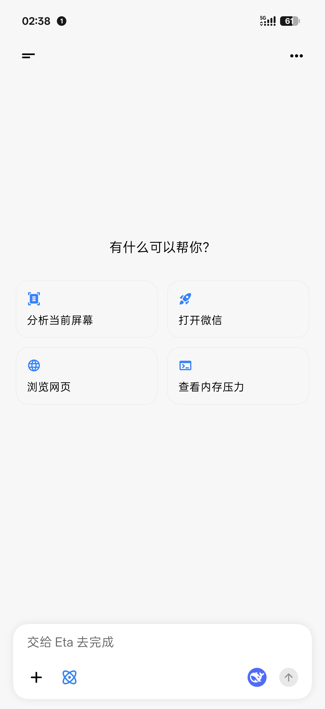 | 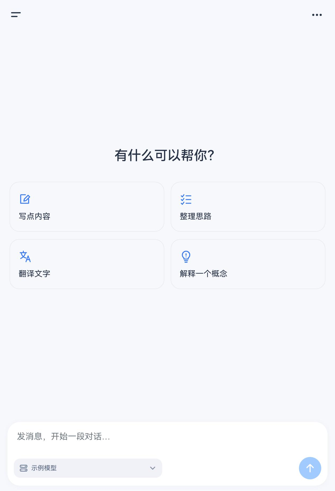 |

原图来自 `Lmin2419/eta-background` 的 commit `8ae286a8993efaa4650426ae450ab4634f2b2354`，文件 `docs/Screenshots/chat_home.jpg`，Git blob `b88e910efed4726e80731b5669b8eb790e9e75b7`。屏幕比例不同，比较页面结构，不宣称逐像素相同。其他页面参考源码，未取得其 Eta 完整截图。

## 实际交互与截图

原生点击路径：建议填入草稿 → 发送 → 流式更新；侧栏 → 服务列表 → 配置 → 测试并获取目录 → 勾选 A、B → 导入 → 返回配置；再次发送 → 停止 → 打开聊天模型选择器。没有直接改应用状态伪造点击。导入前后四项输入相等；样例 Key 为空，非空 Key 仍需实测。

竖屏为 1264×1848，横屏为 2564×1828，320 dpi；横屏是独立启动，未验证折叠过程中的状态保持。预览没有真机键盘和系统栏。

### 01 · 竖屏首页

### 02 · 建议填入草稿

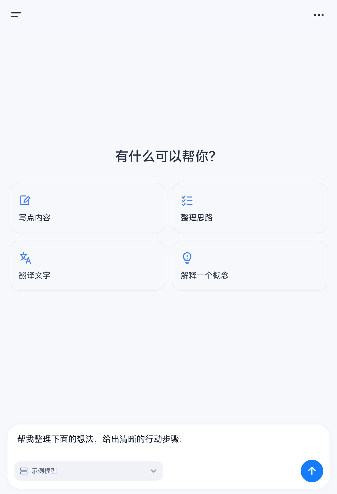

### 03 · 流式中间状态

### 04 · 回复完成

### 05 · 会话侧栏

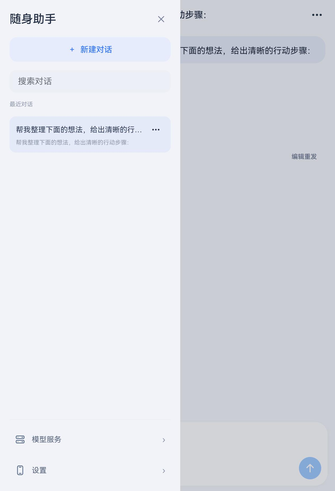

### 06 · 模型服务列表

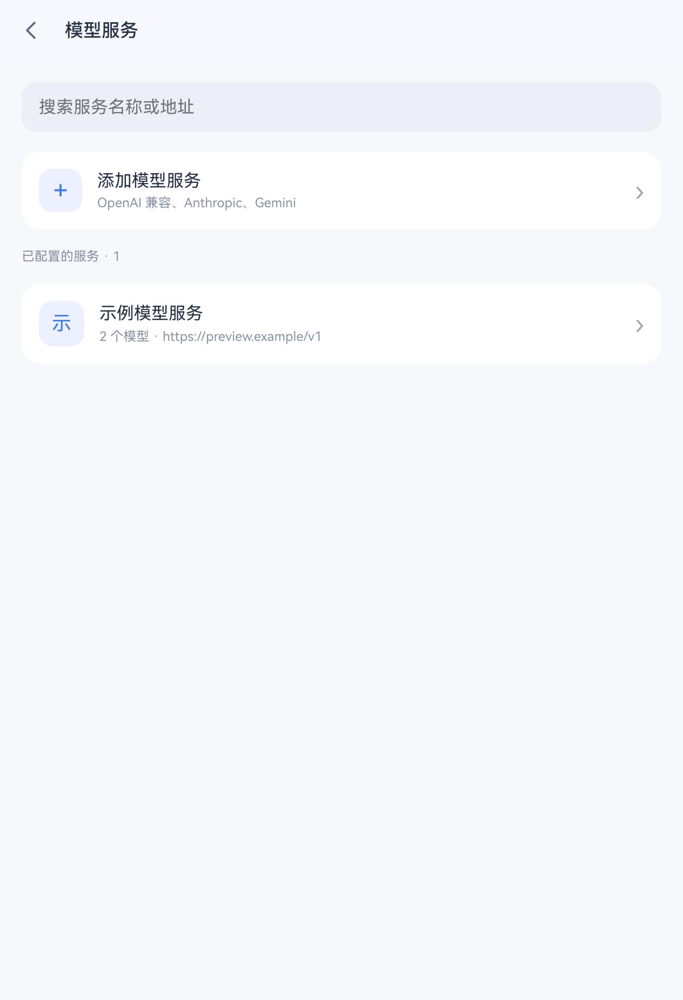

### 07 · 模型配置

### 08 · 远端模型目录

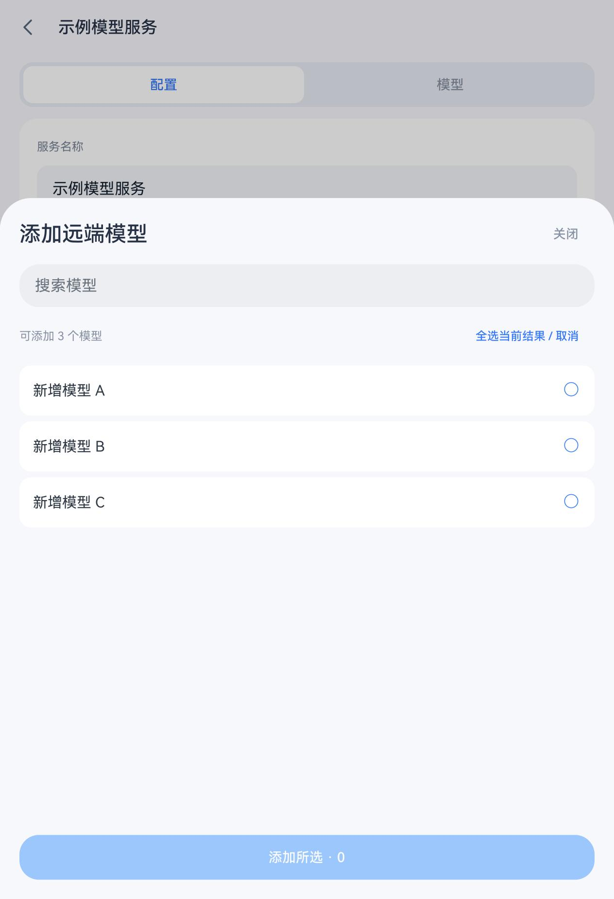

### 09 · 多选两个模型

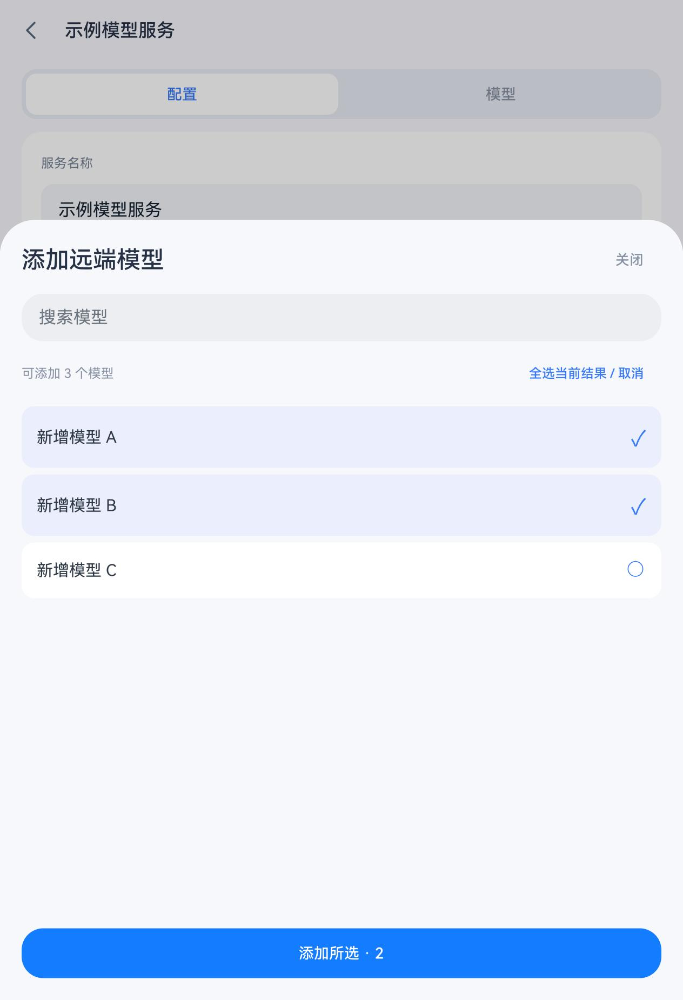

### 10 · 导入后的模型

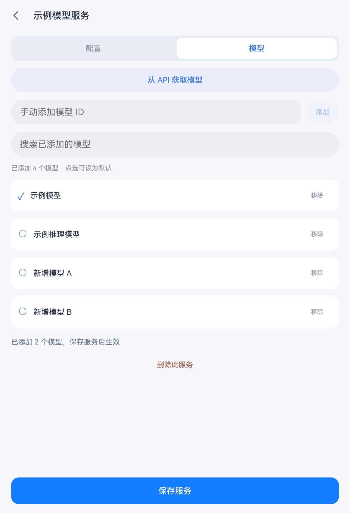

### 11 · 表单值保留

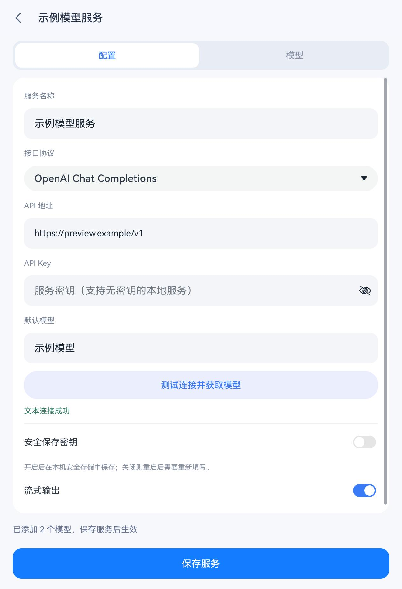

### 12 · 停止并保留部分回复

### 13 · 聊天模型选择器

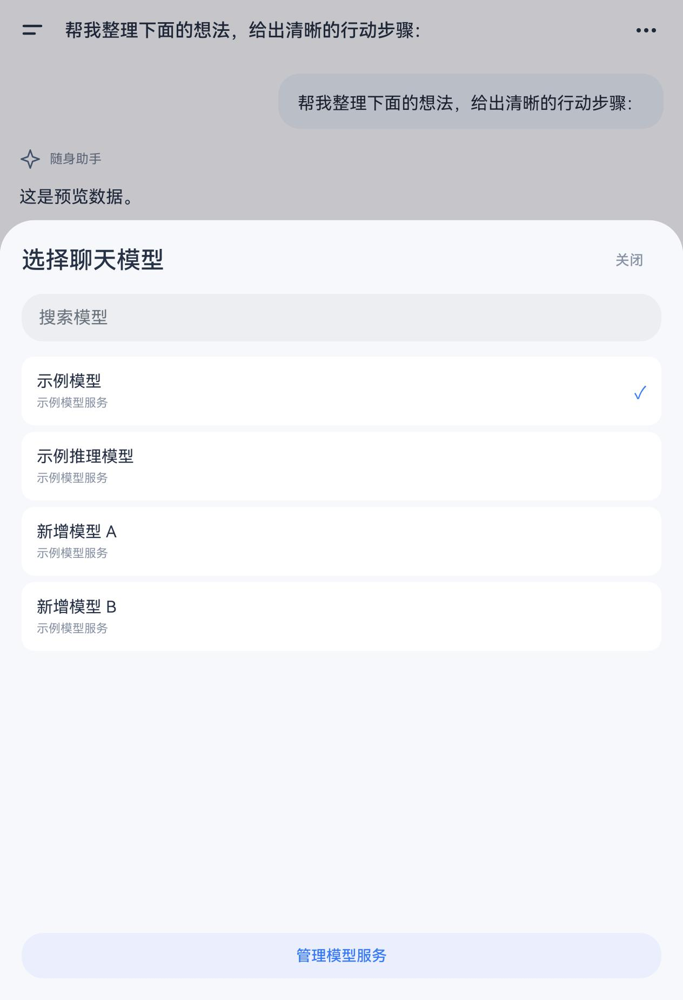

### 14 · 横屏首页

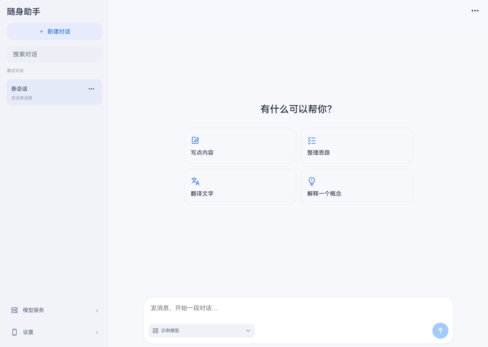

### 15 · 横屏聊天

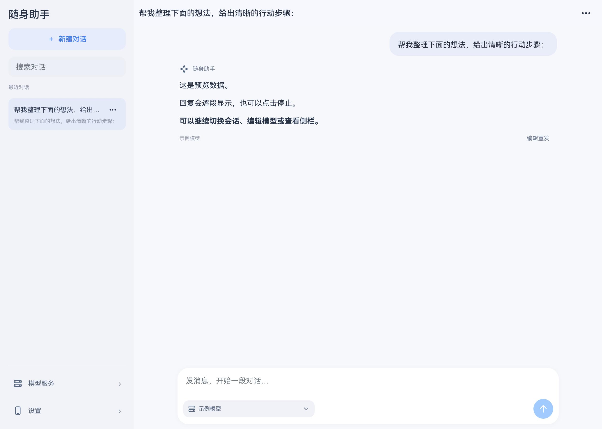

## 验证文件

- [竖屏点击与表单断言](flow.json)
- [停止与聊天模型选择](stop-flow.json)
- [横屏点击轨迹](wide-flow.json)
- [原始控件树 ZIP](native-view-trees.zip)
- [最新 HAP 构建日志](build-native-visual.txt)
- [193 项核心测试日志](test-native-visual.txt)
- [PreviewBuild 日志](build-preview.txt)
- [文件来源与校验值](provenance.json)

TypeScript 检查通过，193 项测试通过、0 失败 / 0 跳过；HAP 与原生 PreviewBuild 成功。桌面预览的点击通过不替代真实 HTTP、ASSET / RDB、输入法、生命周期和签名安装测试。
